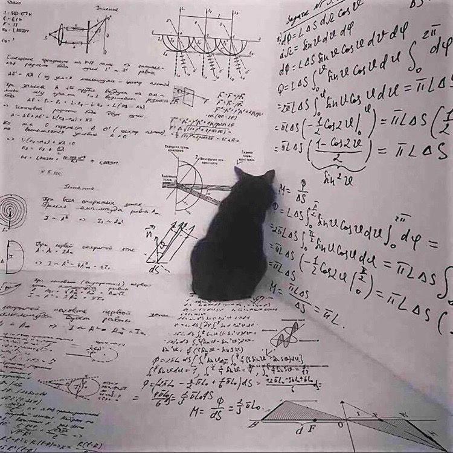
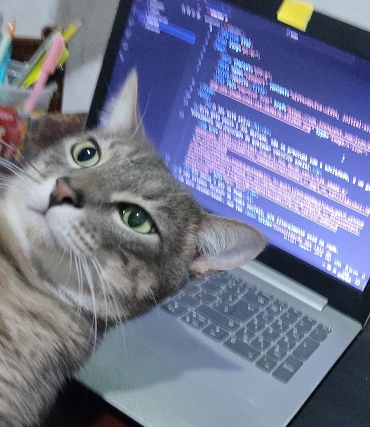

# Hi, I'm Afzal Ansari 👋

### Software Engineer | Backend Engineering | C++ | TypeScript

Competitive Programming · Backend Development · Computer Science

 

---

<h2 align="center">About Me</h2>

<table>
<tr>
<td width="38%" align="center" valign="middle">
  
</td>
<td width="62%" valign="middle">

I'm a Software Engineer focused on backend engineering, competitive programming and problem solving.

I use C++ for Data Structures & Algorithms and competitive programming, while working with JavaScript and TypeScript to build backend applications using Node.js and Express.js. I work with PostgreSQL, MongoDB and Redis for data management and backend development.

My focus is on writing efficient code, understanding core computer science concepts and building reliable backend systems.

</td>
</tr>
</table>

---

<h2 align="left">Projects</h2>

### 01. Writespace

A social blogging platform supporting posts, long-form articles, social interactions, user management and asynchronous notifications.

**Tech Stack**

[Explore Repository →](https://github.com/Afzal14786/writespace)

 

### 02. Redis Clone

A Redis-inspired in-memory data server built from scratch in C++, exploring TCP communication, command processing, data structures, concurrency and file-based persistence.

**Tech Stack**

[Explore Repository →](https://github.com/Afzal14786/redis)

---

<h2 align="center">Technical Skills & Problem Solving</h2>

<table>
<tr>
<td width="62%" valign="middle">

**Languages**

**Backend Development**

**Databases**

**Tools & Technologies**

**Competitive Programming**

Regular problem-solving practice focused on Data Structures & Algorithms, algorithmic thinking and writing efficient solutions.

<a href="https://atcoder.jp/users/iamafzal">
  

</td>
<td width="38%" align="center" valign="middle">
  
</td>
</tr>
</table>

---

<h2 align="center">Let's Connect</h2>

